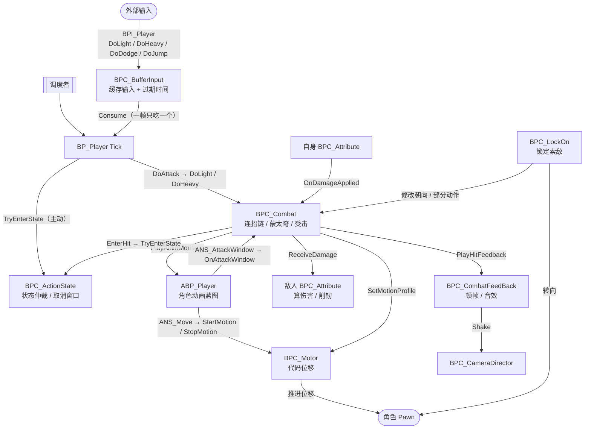
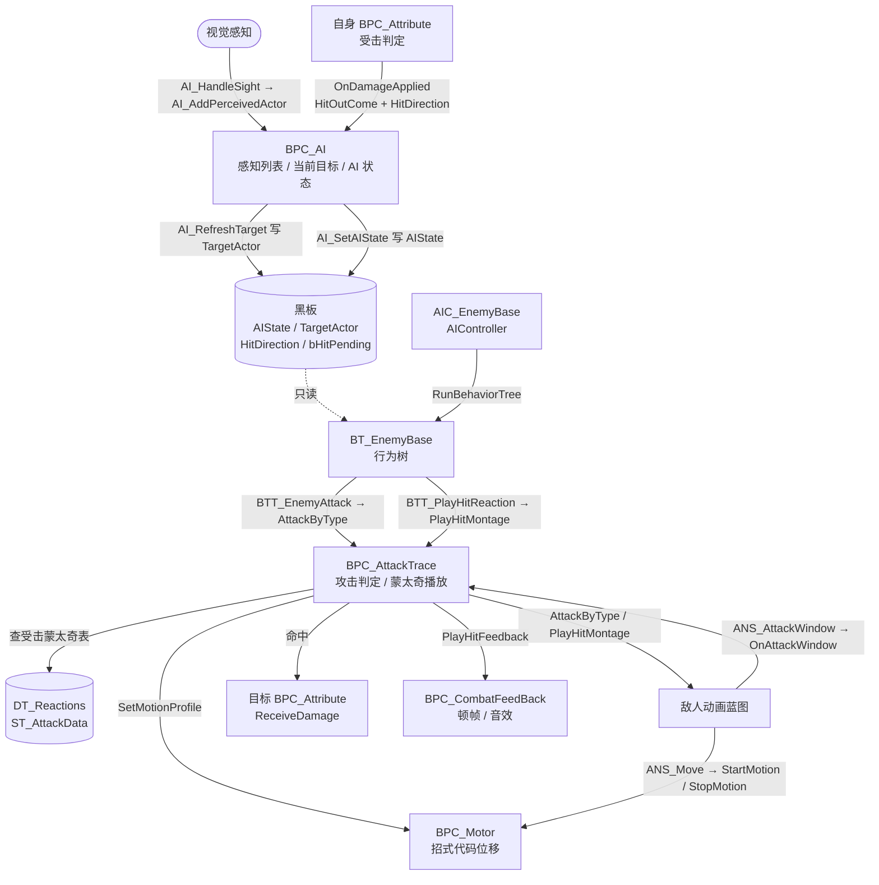

# ActGame

动作战斗游戏 · UE5 蓝图项目

本文件是项目内「组件 / 接口 / 数据结构」的速查表，写蓝图前先对一遍。

> **校对说明**：本文件已按 `Content/` 下的实际资产重新扫描校对（共 15 个 `BPI_`*、10 个 `E_`*、3 个 `ST_*`）。
> **接口函数清单以蓝图编辑器「我的蓝图 → 函数」面板为准** —— UE 的 name table 会保留已删除函数的 FName 条目，直接扫二进制会把历史函数误报成现存函数。
> 与旧版不一致的地方统一记在文末的「七、校对差异清单」里，方便逐条确认。

---

## 目录

- [0，接口总览](#0接口总览) —— 全部接口与函数数的总表，找不到东西先看这里
- [1，CharacterBase（角色基类）](#1characterbase角色基类)
    - [1）CharacterBase 类接口方法](#1characterbase-类接口方法)
        - [BPI_CharacterBase](#1bpi_characterbase)
        - [BPI_Attribute](#2bpi_attribute)
        - [BPI_CombatFeedBack](#3bpi_combatfeedback)
        - [BPI_Motor](#4bpi_motor)
    - [2）CharacterBase 数据类型](#2characterbase-数据类型)
        - [CharacterBase 枚举](#1characterbase-枚举)
        - [结构体](#2结构体)
- [2，Player（玩家特有）](#2player玩家特有继承于-characterbase)
    - [1）Player 类接口方法](#1player-类接口方法)
        - [BPI_Player](#1bpi_player)
        - [BPI_ActionState](#2bpi_actionstate)
        - [BPI_BufferInput](#3bpi_bufferinput)
        - [BPI_CameraDirector](#4bpi_cameradirector)
        - [BPI_Combat](#5bpi_combat)
        - [BPI_LockOn](#6bpi_lockon)
    - [2）Player 数据类型](#2player-数据类型)
        - [Player 枚举](#1player-枚举)
- [3，EnemyBase（敌人角色基类）](#3enemybase敌人角色基类继承于-characterbase)
    - [1）EnemyBase 类接口方法](#1enemybase-类接口方法)
        - [BPI_EnemyBase](#1bpi_enemybase)
        - [BPI_AttackTrace](#2bpi_attacktrace)
        - [BPI_AI](#3bpi_ai)
    - [2）EnemyBase 数据类型](#2enemybase-数据类型)
        - [EnemyBase 枚举](#1enemybase-枚举)
- [4，WeaponBase（武器基类）](#4weaponbase武器基类)
    - [1）WeaponBase 类接口方法](#1weaponbase-类接口方法)
        - [BPI_WeaponBase](#1bpi_weaponbase)
- [5，其他独立接口](#5其他独立接口)
    - [BPI_GameState](#1bpi_gamestatecodegamestate)
    - [BPI_HIt（已删除）](#2bpi_hit)
    - [BPI_Interaction（已删除）](#3bpi_interaction)
- [6，写蓝图时的三条硬规矩](#6写蓝图时的三条硬规矩) —— 分层约定，动手前先读
- [7，玩家侧动画通知与职责](#7玩家侧动画通知与职责) —— 四个动画通知分别调谁
- [8，功能实现](#8功能实现) —— 单个机制的设计细则
    - [1）敌人受击状态机](#1敌人受击状态机) —— 等级、优先级、幂等与重播
    - [2）完美闪避与无敌帧](#2完美闪避与无敌帧) —— 无敌区间 / 完美窗口 / 奖励链
    - [3）闪避方向（四向）](#3闪避方向四向) —— 方向判定、参考系对齐、四行数据
- [9，运行导图](#9运行导图) —— 组件之间的实际流转
    - [1）玩家运行导图](#1玩家运行导图) —— 输入到伤害
    - [2）敌人运行导图](#2敌人运行导图) —— 感知到伤害
- [10，校对差异清单](#10校对差异清单)
    - [已修正的文档错误](#已修正的文档错误)
    - [需要在编辑器里处理的遗留问题](#需要在编辑器里处理的遗留问题)

---

# 注：

```
接口名与其实现的组件名相同
```

## 0，接口总览

| 接口                       | 目录                                 | 函数数 | 对应实现               |
| ------------------------ | ---------------------------------- | --- | ------------------ |
| BPI_CharacterBase        | Code/Interface                     | 8   | 无（纯接口，所有组件获取的统一入口） |
| BPI_Attribute            | Code/ActorComponent/Attribute      | 14  | BPC_Attribute      |
| BPI_CombatFeedBack       | Code/ActorComponent/CombatFeedBack | 4   | BPC_CombatFeedBack |
| BPI_Motor                | Code/ActorComponent/Motor          | 9   | BPC_Motor          |
| BPI_WeaponBase           | Code/Weapon                        | 2   | BP_WeaponBase      |
| BPI_GameState            | Code/GameState                     | 3   | 待接入                |
| BPI_Player               | Player                             | 12  | BP_Player          |
| BPI_ActionState          | Player/Component/ActionState       | 8   | BPC_ActionState    |
| BPI_BufferInput          | Player/Component/BufferInput       | 3   | BPC_BufferInput    |
| BPI_CameraDirector       | Player/Component/CameraDirector    | 1   | BPC_CameraDirector |
| BPI_Combat               | Player/Component/Combat            | 7   | BPC_Combat         |
| BPI_LockOn               | Player/Component/LockOn            | 6   | BPC_LockOn         |
| BPI_EnemyBase            | Enemy                              | 2   | BP_EnemyBase       |
| BPI_AttackTrace          | Enemy/Component/AttackTrace        | 3   | BPC_AttackTrace    |
| BPI_AI                   | Enemy/Component/AI                 | 12  | BPC_AI             |

合计 94 个接口函数。

---

## 1，CharacterBase（角色基类）

| 组件名                | 组件用途      |
| ------------------ | --------- |
| BPC_Attribute      | 角色属性      |
| BPC_CombatFeedBack | 角色攻击音效，顿帧 |
| BPC_Motor          | 角色运动层控制   |

### 1）CharacterBase 类接口方法

#### （1）BPI_CharacterBase

| 方法名                        | 输入                           | 输出                         | 作用                       |
| -------------------------- | ---------------------------- | -------------------------- | ------------------------ |
| GetAttributeComponent      | /                            | BPC_Attribute 对象引用         | 获取角色的 BPC_Attribute      |
| GetCombatFeedbackComponent | /                            | BPC_CombatFeedBack 对象引用    | 获取角色的 BPC_CombatFeedBack |
| GetMotorComponent          | /                            | BPC_Motor 对象引用             | 获取角色的 BPC_Motor          |
| GetCharacterMovement       | /                            | CharacterMovementComponent | 获取角色的移动组件                |
| GetMeshComponent           | /                            | SkeletalMeshComponent      | 获取角色的骨骼网格体组件             |
| GetHitBoxComponent         | /                            | BoxComponent               | 获取角色的受击盒                 |
| GetWeapon                  | /                            | BP_WeaponBase 对象引用         | 获取角色当前武器                 |
| ApplyImpulse               | Vector3，XYOverride，ZOverride | /                          | 按状态计算当前应施加的冲量            |

> **这里是全部「取组件 / 取引用」的唯一入口。**
> `BPI_Player` 与 `BPI_EnemyBase` 不再重复声明 `GetMesh` / `GetHitBox` / `GetWeapon` / `GetAttributeComponent`，写蓝图时统一从基类接口取。

#### （2）BPI_Attribute

| 方法名              | 输入                                   | 输出                     | 作用                                              |
| ---------------- | ------------------------------------ | ---------------------- | ----------------------------------------------- |
| GetAttack        | /                                    | float（Attack）          | 获取角色的攻击值（包括武器基础加成）                              |
| GetDefense       | /                                    | float（Defenses，0~1）    | 获取角色减伤                                          |
| GetPoiseAttack   | /                                    | float（PoiseAttack）     | 获取角色的削轫值（包括武器基础加成）                              |
| AddBonus         | float（AttackDelta）                   | /                      | 添加武器加成                                          |
| IsDead           | /                                    | bool（Dead）             | 角色是否死亡                                          |
| TakeDamage       | float（BaseDamage），float（PoiseDamage） | bool（bIsBroken）        | 扣血扣韧，返回是否破韧。**内部不再乘防御**                         |
| ReceiveDamage    | ST_AttackData，float，Vector3，float    | E_HitOutCome，bool，bool | 完整受击判定：攻击数据、基础伤害、受击位置、基础削轫 → 受击类型、是否完美格挡、是否完美闪避 |
| ClearPoseBroken  | /                                    | /                      | 清除削轫破防效果                                        |
| RestorePoise     | /                                    | /                      | 恢复韧性到 MaxPoise（Tick 里调用）                        |
| EnterGuard       | /                                    | /                      | 进入格挡：置 bIsGuarding，记录 LastGuardTime             |
| ExitGuard        | /                                    | /                      | 退出格挡                                            |
| NotifyDodgeStart | float（Time）                          | /                      | 记录闪避起手时刻，供完美闪避窗口判定使用                            |
| SetInvincible    | bool（bInvincible）                     | /                      | 开关无敌。由 `ANS_IFrame` 的 Begin / End 调用              |
| EndPerfectDodge  | /                                    | /                      | 完美闪避收尾：若仍在无敌则关无敌并补一段尾巴。由 Combat 调用 |

`ReceiveDamage` **的三个输出含义：**

| 输出              | 含义                                        |
| --------------- | ----------------------------------------- |
| HitOutCome      | `Ignore` 无伤 / `Hit` 普通受击 / `Blocked` 格挡生效 |
| bPerfectBlock   | 是否完美格挡（完全免伤）                              |
| bPerfectDodge   | 是否完美闪避（在无敌帧内**且**处于完美窗口）                  |

**判定优先级（顺序不能调）：**

```
① 已死亡                        → Ignore
② 无敌中（bInvincible 或 无敌尾巴）
     且在完美窗口内              → Ignore + bPerfectDodge = true
     仅无敌、不在完美窗口        → Ignore，bPerfectDodge = false
③ 格挡 + 正面 + Poise>0         → 完美格挡窗口内？Blocked + bPerfectBlock 免伤
                                  否则 Blocked，伤害 ×(1−GuardDamageReduction)，削轫 ×GuardPoiseScale
④ 其余（含背面格挡）             → Hit，伤害 ×(1−Defense)
```

**② 的两个条件是 `AND`：只判时间会把闪避结束后的受击误判成完美；只判无敌会把整个无敌区间都算成完美，缓冲带就没了。**

**韧性为 0 时格挡完全失效，完美格挡也一并失效。**

#### （3）BPI_CombatFeedBack

| 方法名             | 输入                                            | 输出  | 作用                                            |
| --------------- | --------------------------------------------- | --- | --------------------------------------------- |
| PlayHitFeedback | E_HitOutCome（Outcome），Vector3（ImpactLocation），bool（bPerfect），Actor（OtherActor），float（BaseHitStop） | /   | 播放命中音效、顿帧、屏幕抖动                                |
| PlayHitStop     | Actor，float                                   | /   | 根据命中者与时长播放顿帧                                  |
| EndHitStop      | /                                             | /   | 离开顿帧                                          |
| PlayPerfectDodgeSlowMo | /                                      | /   | 播放完美闪避的全局慢动作（自带恢复计时）                          |

#### （4）BPI_Motor

| 方法名                | 输入                          | 输出   | 作用               |
| ------------------ | --------------------------- | ---- | ---------------- |
| ApplyKnockback     | Vector3（Force），bool（bIgnoreMove） | /    | 施加一个冲量           |
| SetMotionProfile   | ST_MotionProfile（profile）   | /    | 设置代码位移的基础变量      |
| StartMotion        | /                           | /    | 开始代码位移           |
| StopMotion         | /                           | /    | 停止代码位移           |
| IsMoving           | /                           | bool | 当前是否在代码位移中       |
| IsBeingKnockedBack | /                           | bool | 当前是否在被击退         |
| SetGravity         | float（Scale）               | /    | 设置重力倍率           |
| ResetGravity       | /                           | /    | 重力恢复默认值          |
| SetMotionScale     | float（Scale）               | /    | 位移速度倍率。完美闪避时降到 0.3 控距离，收尾必须复位为 1.0 |

### 2）CharacterBase 数据类型

#### （1）CharacterBase 枚举

##### 一，E_AttackType（攻击类型）

| 枚举值    | 枚举含义 |
| ------ | ---- |
| Common | 普通攻击 |

##### 二，E_HitOutCome（受击类型）

| 枚举值     | 枚举含义 |
| ------- | ---- |
| Ignore  | 忽略   |
| Hit     | 普通受击 |
| Blocked | 防御   |

##### 三，E_HitDirection

| 枚举值   | 枚举含义 |
| ----- | ---- |
| Front | 前方   |
| Back  | 后方   |
| Left  | 左边   |
| Right | 右边   |

#### （2）结构体

##### 一，ST_AttackData

| 值名               | 类型           | 默认值     | 含义                           |
| ---------------- | ------------ | ------- | ---------------------------- |
| ID               | name         | none    | 动作名                          |
| Montage          | 动画蒙太奇        | none    | 动作播放的 montage                |
| SectionStart     | name         | none    | montage 开始播放的片段              |
| Next             | ST_Edge 数组   | none    | 下一个动作名以及进入所需的操作              |
| CancelStart      | float        | 0       | 取消窗口打开的时间                    |
| DamageRate       | float        | 0       | 伤害倍率                         |
| PoiseDdamageRate | float        | 0       | 削轫倍率（**资产里就是两个 d，别改成 Ddamage 以外**） |
| HitStop          | float        | 0       | 顿帧时长                         |
| LaunchEnemy      | Vector3      | （0，0，0） | 命中敌人时对敌人的力                   |
| LaunchSelf       | Vector3      | （0，0，0） | 命中敌人时对自己的力                   |
| MotionSelf       | Vector3      | （0，0，0） | xy 表示位移方向，z 表示对角色向上的力        |
| CanUseInAir      | bool         | false   | 是否可以在空中使用                    |
| PlayGravity      | float        | 1       | 使用时角色的重力                     |
| MoveSpeed        | float        | 600     | 水平移动速度（大于 610 才有代码位移）        |
| MoveFriction     | float        | 8       | 移动时角色摩擦力                     |
| bLockPelvisZ     | bool         | false   | 是否锁定 Pelvis 骨骼的 z 坐标         |
| AttackType       | E_AttackType | Common  | 动作的攻击类型                      |

##### 二，ST_Edge

| 值名     | 类型          | 默认值  | 含义           |
| ------ | ----------- | ---- | ------------ |
| NextID | name        | none | 下一个动作的 ID    |
| Input  | E_InputType | none | 进入下一个动作所需的输入 |

##### 三，ST_MotionProfile

| 值名           | 类型      | 默认值     | 含义   |
| ------------ | ------- | ------- | ---- |
| speed        | float   | 0       | 水平速度 |
| direction    | vector3 | （0，0，0） | 水平方向 |
| friction     | float   | 8       | 摩擦力  |
| gravityScale | float   | 1       | 重力大小 |

---

## 2，Player（玩家特有）（继承于 CharacterBase）

| 组件名                | 组件用途     |
| ------------------ | -------- |
| BPC_ActionState    | 玩家当前状态   |
| BPC_BufferInput    | 玩家输入缓存   |
| BPC_CameraDirector | 玩家相机控制   |
| BPC_Combat         | 玩家角色动作控制 |
| BPC_LockOn         | 玩家索敌控制   |

### 1）Player 类接口方法

#### （1）BPI_Player

| 方法名                     | 输入   | 输出                      | 作用                     |
| ----------------------- | ---- | ----------------------- | ---------------------- |
| GetActionStateComponent | /    | BPC_ActionState 对象引用    | 获取 BPC_ActionState     |
| GetCombatComponent      | /    | BPC_Combat 对象引用         | 获取 BPC_Combat          |
| GetBufferInputComponent | /    | BPC_BufferInput 对象引用    | 获取 BPC_BufferInput     |
| GetCameraDirectorComponent | /  | BPC_CameraDirector 对象引用 | 获取 BPC_CameraDirector（相机控制组件） |
| GetCameraComponent      | /    | CameraComponent         | 获取角色的 CameraComponent（相机组件） |
| GetLockComponent        | /    | BPC_LockOn 对象引用         | 获取 BPC_LockOn          |
| StartJump               | /    | /                       | 让角色跳跃                  |
| IntoHardLockState       | /    | /                       | 进入硬锁                   |
| OutHardLockState        | /    | /                       | 退出硬锁                   |
| SetLockPlevisZ          | bool | /                       | 设置是否锁定 Plevis 骨骼的 z 位置 |
| StartAfterimage         | /    | /                       | 开始按 `GhostInterval` 循环生成残影。**由完美闪避启动** |
| StopAfterimage          | /    | /                       | 停止生成残影并清空计数数组。**已生成的残影不销毁，交给各自淡出** |

> `GetMesh`、`GetHitBox`、`GetWeapon`、`GetAttributeComponent`、`GetCharacterMovement` **已全部上收到** `BPI_CharacterBase`，玩家侧不再各自声明。写蓝图时统一走基类接口。

> **`GetCameraComponent` 与 `GetCameraDirectorComponent` 是两个不同的东西，可以同时存在：**

```
CameraComponent         UE 自带的相机组件 —— 挂在角色上的实际摄像机
BPC_CameraDirector      项目自研的相机控制组件 —— 锁定、震动、视角过渡
                        它不持有相机，只下指令
```

#### （2）BPI_ActionState

| 方法名             | 输入                      | 输出            | 作用                                        |
| --------------- | ----------------------- | ------------- | ----------------------------------------- |
| TryEnterState   | E_ActionState（NewState） | bool          | 一级状态转换：走转场矩阵与受控状态优先级。**永远不能回 Locomotion** |
| ForceEnterState | E_ActionState（NewState） | bool          | 二级状态转换：连招续接。需取消窗口打开，不受控状态下一律无效            |
| SetState        | E_ActionState（NewState） | /             | 收尾复位，无校验、幂等。**唯一能回 Locomotion 的入口**       |
| GetActionState  | /                       | E_ActionState | 获取角色当前状态                                  |
| SetCancelWindow | bool                    | /             | 开关取消窗口。只允许 Combat 与动画通知调用                 |
| CanDodge        | /                       | bool          | 当前是否可以冲刺（受 CD 与非受控状态约束）                   |
| UpdateDodgeCD   | float（Time）             | /             | 记录冲刺起手时刻，用于 CD 判定                         |
| ClearDodgeCD    | /                       | /             | 清空冲刺冷却。**仅供完美闪避调用**，让玩家立刻可以再闪              |

**三个转换入口的分工：**

```
TryEnterState    状态层说了算 —— 查转场矩阵
ForceEnterState  战斗层说了算 —— 战斗层已判定连招成立，状态层照做
SetState         不用判断   —— 复位收尾
```

**受控状态（HitLight / HitHeavy / KnockDown / Dead）内部有优先级，可升级、可幂等，不可降级、不可逃逸。**

#### （3）BPI_BufferInput

| 方法名     | 输入          | 输出   | 作用                 |
| ------- | ----------- | ---- | ------------------ |
| Push    | E_InputType | /    | 向缓存中推入新的输入         |
| Comsume | E_InputType | bool | 读取缓存中的指定输入，并返回是否成功 |
| Peek    | E_InputType | bool | 看缓存中是否有指定且没过期的输入   |

#### （4）BPI_CameraDirector

| 方法名   | 输入                              | 输出  | 作用                           |
| ----- | ------------------------------- | --- | ---------------------------- |
| Shake | E_CameraShakeType，Vector3，float | /   | 根据抖动类型、受击位置、强度制造屏幕抖动         |

#### （5）BPI_Combat

| 方法名              | 输入   | 输出            | 作用             |
| ---------------- | ---- | ------------- | -------------- |
| DoLight          | /    | /             | 操作轻击           |
| DoHeavy          | /    | /             | 操作重击           |
| DoJump           | /    | /             | 操作跳跃           |
| DoDodge          | /    | /             | 操作冲刺           |
| GetCurrentAttack | /    | ST_AttackData | 获取当前动作的数据      |
| OnAttackWindow   | bool | /             | 开关攻击窗口（由 ANS_AttackWindow 触发） |
| EnterHit         | E_ActionState，E_HitDirection | /   | 进入受击处理（由 Attribute 的 OnDamageApplied 触发） |

> **位移不再经过 Combat。** `ANS_Move` 直接调 `BPI_Motor.StartMotion` / `StopMotion`，
> Combat 只负责在动作开始时用 `SetMotionProfile` 下发速度和方向。
> 原先的 `MoveStart` / `MoveEnd` 两个纯转发函数已删除。

#### （6）BPI_LockOn

| 方法名              | 输入  | 输出            | 作用        |
| ---------------- | --- | ------------- | --------- |
| GetFocusTarget   | /   | Actor         | 获取当前锁定的对象 |
| GetTarget        | /   | Actor         | 获取候选/当前目标 |
| GetLockState     | /   | E_LockOnState | 获取当前锁定状态  |
| HardLockPress    | /   | /             | 硬锁键按下     |
| HardLockRelease  | /   | /             | 硬锁键松开     |
| SimpleAimCorrect | /   | /             | 软锁下修正角色朝向 |

### 2）Player 数据类型

#### （1）Player 枚举

##### 一，E_ActionState

| 枚举值        | 枚举含义                     |
| ---------- | ------------------------ |
| Locomotion | 一般状态（最低级，回它只能走 SetState） |
| Jump       | 跳跃状态（含下落）                |
| Attack     | 攻击状态                     |
| Dodge      | 冲刺状态                     |
| Guard      | 格挡状态                     |
| HitLight   | 轻受击（受控）                  |
| HitHeavy   | 重受击（受控）                  |
| KnockDown  | 倒地（受控）                   |
| Dead       | 死亡（受控，绝对终态）              |

##### 二，E_CameraShakeType（屏幕抖动类型）

| 枚举值          | 枚举含义   |
| ------------ | ------ |
| Hit          | 普通受击抖动 |
| Block        | 格挡抖动   |
| PerfectBlock | 完美格挡抖动 |
| Break        | 破韧抖动   |
| Kill         | 死亡抖动   |

##### 三，E_InputType

| 枚举值     | 枚举含义 |
| ------- | ---- |
| Light   | 轻击   |
| Heavy   | 重击   |
| Dodge   | 冲刺   |
| Jump    | 跳跃   |
| Execute | 处决   |

##### 四，E_LockOnState（锁定状态）

| 枚举值  | 枚举含义 |
| ---- | ---- |
| None | 无锁定  |
| Soft | 软锁   |
| Hard | 硬锁   |

##### 五，E_MoveState（移动状态）

| 枚举值  | 枚举含义 |
| ---- | ---- |
| Idle | 站立   |
| Walk | 走路   |
| Run  | 奔跑   |

---

> 玩家运行导图 → [9，运行导图 · 1）玩家运行导图](#1玩家运行导图)

---

## 3，EnemyBase（敌人角色基类）（继承于 CharacterBase）

| 组件名             | 组件用途      |
| --------------- | --------- |
| BPC_AI          | 敌人 AI 控制  |
| BPC_AttackTrace | 敌人攻击判定    |
| BPC_Attribute   | 复用 CharacterBase 的属性组件 |

### 1）EnemyBase 类接口方法

#### （1）BPI_EnemyBase

| 方法名                     | 输入  | 输出                  | 作用                     |
| ----------------------- | --- | ------------------- | ---------------------- |
| GetAttackTraceComponent | /   | BPC_AttackTrace 对象引用 | 获取 BPC_AttackTrace      |
| GetAIComponent          | /   | BPC_AI 对象引用          | 获取 BPC_AI               |

> `GetMesh`、`GetHitBox`、`GetEnemyAttributeComponent` **已全部上收到** `BPI_CharacterBase`（属性统一走 `GetAttributeComponent`），敌人侧不再各自声明。

#### （2）BPI_AttackTrace

| 方法名            | 输入                                    | 输出   | 作用                    |
| -------------- | ------------------------------------- | ---- | --------------------- |
| OnAttackWindow | bool                                  | /    | 开关攻击窗口                |
| AttackByType   | E_AttackType                          | /    | 根据攻击类型发动攻击            |
| PlayHitMontage | E_AIState（受击等级），E_HitDirection（受击方向） | bool | 查蒙太奇表并播放敌人的受击蒙太奇      |

#### （3）BPI_AI

| 方法名                     | 输入                             | 输出        | 作用                        |
| ----------------------- | ------------------------------ | --------- | ------------------------- |
| AI_AddPerceivedActor    | Actor                          | /         | 添加感受到的对象                  |
| AI_RemovePerceivedActor | Actor                          | /         | 从感受列表中删除对象                |
| AI_GetCurrentTarget     | /                              | Actor     | 获取当前锁定的对象                 |
| AI_RefreshTarget        | /                              | /         | 重算并写入黑板 TargetActor       |
| AI_GetAIState           | /                              | E_AIState | 获取当前 AI 状态                |
| AI_SetAIState           | E_AIState（NewState）            | bool      | 带优先级闸门的状态转换，返回目标状态是否达成    |
| AI_ResetAIState         | E_AIState（NewState）            | bool      | 强制转场（绕过优先级），死亡状态不可转出      |
| AI_GetHitStamp          | /                              | int       | 取当前受击戳，供表现层读取             |
| AI_ConsumeHit           | int（Stamp）                    | bool      | 表现层回写已消费的戳，返回是否已全部消费完     |
| AI_IsAlive              | /                              | bool      | 角色当前是否活着                  |
| AI_HandleSight          | Actor，bool（bSensed）           | /         | 处理视觉感知的进入/丢失              |
| HandleDamageApplied     | E_HitOutCome，E_HitDirection，bool | /         | 受击后由 Attribute 的 OnDamageApplied 回调 |

### 2）EnemyBase 数据类型

#### （1）EnemyBase 枚举

##### 一，E_AIState

| 枚举值       | 枚举含义    |
| --------- | ------- |
| Idle      | 站立（待机）  |
| Chase     | 追击      |
| Attack    | 攻击      |
| HitLight  | 轻受击（受控） |
| HitHeavy  | 重受击（受控） |
| KnockDown | 倒地（受控）  |
| Dead      | 死亡（受控）  |

---

> 敌人运行导图 → [9，运行导图 · 2）敌人运行导图](#2敌人运行导图)
> 受击状态机 → [8，功能实现 · 1）敌人受击状态机](#1敌人受击状态机)

---

## 4，WeaponBase（武器基类）

### 1）WeaponBase 类接口方法

#### （1）BPI_WeaponBase

| 方法名             | 输入  | 输出    | 作用             |
| --------------- | --- | ----- | -------------- |
| GetWeaponBonus  | /   | float | 获取武器的攻击力加成     |
| GetWeaponHitBox | /   | 盒体碰撞  | 获取武器碰撞箱        |

---

## 5，其他独立接口

### （1）BPI_GameState（Code/GameState）

| 方法名         | 输入            | 输出   | 作用        |
| ----------- | ------------- | ---- | --------- |
| AddToken    | Actor（Holder） | /    | 为持有者登记令牌  |
| RemoveToken | Actor（Holder） | /    | 移除持有者的令牌  |
| HasToken    | Actor（Holder） | bool | 查询持有者是否有令牌 |

### （2）BPI_HIt

**已删除。`EnterHit` 已合并进 `BPI_Combat`，签名改为 `EnterHit(E_ActionState HitType, E_HitDirection HitLoc)`。**

### （3）BPI_Interaction

**已删除（原为空壳，0 个函数）。**

---

## 6，写蓝图时的三条硬规矩

```
① 状态层（BPC_ActionState）不引用任何其他组件
   它只管 CurrentState、bCanCancel 和转场规则

② 伤害规则全部收在 BPC_Attribute
   无敌、完美格挡、完美闪避、减伤、削轫、破韧都在这一个地方判定

③ 战斗层负责「用什么参数」，动画通知负责「什么时候」
   Combat → SetMotionProfile / 调 ReceiveDamage / 调 PlayHitFeedback
   通知   → Motor.StartMotion / StopMotion（位移窗口和动画帧对齐）
   Motor  → 只执行，不判断该不该动

   位移**不**经过 Combat。ANS_Move 直连 BPI_Motor
```

`BPC_CombatFeedBack` **内部再调** `BPC_CameraDirector.Shake`**，Combat 不直接碰 CameraDirector。**

---

## 7，玩家侧动画通知与职责

| 通知                 | 类型          | 调用的接口                                  | 职责                                        |
| ------------------ | ----------- | -------------------------------------- | ----------------------------------------- |
| `ANS_AttackWindow` | NotifyState | `BPI_Combat.OnAttackWindow(bool)`      | 开合攻击判定窗口，驱动 AttackTrace 的命中检测             |
| `ANS_Move`         | NotifyState | `BPI_Motor.StartMotion` / `StopMotion` | 开合代码位移窗口                                  |
| `ANS_LandCheck`    | NotifyState | 自有逻辑（不经过 Combat）                       | 落地检测                                      |
| `AN_Cancel`        | Notify      | 目前**未接** `SetCancelWindow`             | 取消窗口时机改由 `ST_AttackData.CancelStart` 数据驱动 |

**三个要点：**

```
① 通知统一走 BPI_CharacterBase → GetMotorComponent / GetCombatComponent
   Cast 目标是基类接口，不 Cast To BPI_Player
   → 敌人挂同一套通知也不用改

② 位移窗口由通知控制，不是「整个蒙太奇都在动」
   → 前摇不会提前滑出去，位移只发生在配了 ANS_Move 的那一段

③ AN_Cancel 目前是空壳
   取消窗口由 Combat 按 CancelStart 自己开合
   要么删掉这个通知，要么改成让它调 SetCancelWindow —— 别两边都做
```

---

## 8，功能实现

> 单个机制的设计细则：规则、判定顺序、数据来源。
> 只讲「怎么判」，不讲「谁调谁」—— 组件流转看 [9，运行导图](#9运行导图)。

### 1）敌人受击状态机

敌人没有 `BPC_ActionState`，受击状态由 `BPC_AI` 自己维护。
**所有转换规则收在 `AI_SetAIState` 一个入口里，行为树只读状态、不做判断。**

#### （1）状态分级

| E_AIState | Priority | 受控 | 说明     |
| --------- | -------- | -- | ------ |
| Idle      | 0        | 否  | 待机     |
| Chase     | 0        | 否  | 追击     |
| Attack    | 0        | 否  | 攻击     |
| HitLight  | 1        | 是  | 轻受击    |
| HitHeavy  | 2        | 是  | 重受击    |
| KnockDown | 3        | 是  | 倒地     |
| Dead      | 4        | 是  | 死亡（终态） |

> 蓝图里落地为 `AIStateProperty` 映射表，字段：`Priority` / `IsControlled`。

#### （2）三条不变量

```
① 所有非受控状态的 Priority 必须为 0
   「不可转出」是「非受控 0 < 受控 ≥1」的推论。
   一旦给某个非受控状态更高优先级，转出规则会静默失效，而且不会报错。

② Dead 是唯一禁止幂等的状态
   Dead → Dead 返回 false；其余同级转换返回 true。

③ AI_ResetAIState 是受控状态的唯一出口
   它能绕过优先级闸门，只允许受击表现播完后调用。
   别的地方想改状态一律走 AI_SetAIState。
```

#### （3）AI_SetAIState —— 只升不降

```
[1] NewState == Dead ?
      CurrentState == Dead → return false        （死亡禁止幂等）
      否则 ApplyState(Dead); return true          （死亡从任何状态都能进）

[2] NewState == CurrentState ?
      return true                                （幂等命中，不写黑板）

[3] Priority(New) < Priority(Current) ?
      return false                               （降级 / 转出 一并拦下）

[4] ApplyState(New); return true
```

**返回值语义：`true` = 调用结束后当前状态等于 NewState（无论是刚写入还是本来就是）；`false` = 没达成。**

判断表：

| Current   | New       | 出口 | 返回        |
| --------- | --------- | -- | --------- |
| Idle      | Chase     | 4  | true      |
| Chase     | HitLight  | 4  | true      |
| HitLight  | HitLight  | 2  | true（幂等）   |
| HitLight  | HitHeavy  | 4  | true（升级）   |
| HitHeavy  | HitLight  | 3  | false（降级）  |
| HitHeavy  | Chase     | 3  | false（转出）  |
| KnockDown | Attack    | 3  | false（转出）  |
| 任意非 Dead  | Dead      | 1  | true      |
| Dead      | Dead      | 1  | **false** |
| Dead      | HitLight  | 3  | false     |

#### （4）AI_ResetAIState —— 强制转场

```
[1] CurrentState == Dead ?
      return false                               （死亡不可转出）

[2] NewState == CurrentState ?
      return true                                （幂等短路，省一次黑板写）

[3] ApplyState(NewState); return true
```

它**不判优先级** —— 受控状态永远过不了 `AI_SetAIState` 的闸门，回不到普通状态，只能从这里出去。

#### （5）重播机制：状态幂等 ≠ 表现幂等

受击状态是幂等的（`HitLight → HitLight` 状态不变），但**表现必须重播**（连砍两刀要看到两次受击）。
这个矛盾靠两个计数器把「状态」和「表现」解耦：

```
HitStamp       每次状态被接受时 +1，永不清零
HandledStamp   表现层（BTT_PlayHitReaction）已消费到哪
bHitPending    = (HitStamp != HandledStamp)，实时写入黑板
```

**三个写入点：**

```
ApplyState           → CurrentState + 黑板 AIState（+ bControlled）
HandleDamageApplied  → 状态被接受后 HitStamp++，再刷黑板
AI_ConsumeHit        → HandledStamp = max(本次 Stamp)，再刷黑板
```

**时序：**

| 时刻 | 事件                    | HitStamp | HandledStamp | bHitPending |
| -- | --------------------- | -------- | ------------ | ----------- |
| T0 | 初始                    | 0        | 0            | false       |
| T1 | 挨第一刀，状态被接受            | **1**    | 0            | **true**    |
| T2 | Task 执行，先消费再播          | 1        | **1**        | **false**   |
| T3 | 播放中挨第二刀（同级）           | **2**    | 1            | **true**    |
| T4 | 旧蒙太奇被新蒙太奇覆盖，新 Task 消费 | 2        | **2**        | **false**   |
| T5 | 播完，无新受击，复位            | 2        | 2            | false       |

> **`AI_ConsumeHit` 必须放在 Task 执行的开头**：它把 `bHitPending` 置回 false，下一次受击才能产生 `false → true` 的边沿，从而立刻打断上一轮、由新蒙太奇覆盖旧蒙太奇。

#### （6）黑板键

| 键            | 类型              | 写入方                 | 说明                       |
| ------------ | --------------- | ------------------- | ------------------------ |
| AIState      | E_AIState       | ApplyState          | 状态机同步                    |
| bHitPending  | bool            | SyncBlackboard      | 是否有未消费的受击                |
| HitDirection | E_HitDirection  | HandleDamageApplied | 本次受击方向，只与 HitStamp 同步更新   |
| TargetActor  | Actor           | AI_RefreshTarget    | 当前目标                     |
| DisToTarget  | float           | AI 服务              | 与目标距离                    |

**行为树的 Task 和 Decorator 一律只读黑板，不直接写；所有写入都经过 `BPC_AI`。**

#### （7）受击蒙太奇表

| 项     | 内容                                              |
| ----- | ----------------------------------------------- |
| 资产    | `Player/DataTable/DT_Reactions`（敌我共用）            |
| 行结构   | `ST_AttackData`                                 |
| 行名格式  | `{受击等级}_{受击方向}`，例如 `HitLight_Front`             |
| 现有行   | `HitLight` / `HitHeavy` × `Front` / `Back` / `Left` / `Right` |
| 查表回退  | 先找 `{等级}_{方向}`，找不到再找 `{等级}`（倒地 / 死亡不分方向） |
| 播放方式  | 覆盖式播放，不手动 Stop 旧蒙太奇                             |

**受击行里只认以下字段，其余（`DamageRate` / `PoiseDdamageRate` / `Next` / `CancelStart` / `AttackType` 等）在受击语境下无效：**

```
✅ Montage     受击动画
✅ HitStop     受击顿帧
🚫 其余        留空
```

**⚠️ 拼行名不要用 `Enum to String`** —— 它的输出带 `E_AIState::` 前缀或受 DisplayName 影响，拼出来的行名查不到，而且查表失败是静默的。用 `Switch` 映射到字面量。

---

### 2）完美闪避与无敌帧

#### （1）三个概念必须分开

| 概念 | 定义 | 由什么决定 |
| --- | --- | --- |
| 无敌帧 | 闪避动作中一段完全免伤的区间 | `ANS_IFrame` → `SetInvincible(bool)` |
| 完美窗口 | 闪避起手后 N 毫秒 | `NotifyDodgeStart` + `PerfectDodgeWindow`（纯计时） |
| 奖励 | 判定成功后给什么 | `OnPerfectDodge` 分发器 |

```
无敌是「一段区间」 → 用动画通知表达，美术能随动作调
完美是「一个瞬间」 → 用纯计时表达，手感全局统一
两者完全独立，谁先结束都不影响另一方
```

#### （2）变量

**`BPC_Attribute`** —— 判定层

| 变量 | 类型 | 默认 | 说明 |
| --- | --- | --- | --- |
| `LastDodgeTime` | float | 0 | 闪避起手时刻，由 `NotifyDodgeStart` 写入 |
| `PerfectDodgeWindow` | float | 0.15 | 完美窗口长度 |
| `bInvincible` | bool | false | 动画无敌，**只由 `ANS_IFrame` 的 Begin / End 改** |
| `bInvincibleTail` | bool | false | 收尾时补的无敌尾巴，**只由内部计时器改** |
| `PerfectDodgeTailDuration` | float | 0.15 | 尾巴时长 |
| `TailTimerHandle` | TimerHandle | — | 尾巴计时器 |
| `bPerfectDodgeUsed` | bool | false | 本轮闪避是否已奖励过，由 `NotifyDodgeStart` 复位 |

**`BPC_Combat`** —— 收尾层

| 变量 | 类型 | 默认 | 说明 |
| --- | --- | --- | --- |
| `PerfectDodgeCancelDelay` | float | 0.25 | 收尾的时间上限，**早于慢动作结束**，见（6） |
| `PerfectDodgeMaxDistance` | float | 150 | 收尾的距离上限，**从完美闪避判定成功点累计** |
| `DodgeStartLocation` | Vector | — | 判定成功时的位置，`HandlePerfectDodge` 里记录 |
| `PerfectDodgeFinishTimer` | TimerHandle | — | 时间上限计时 |
| `bPerfectDodgePending` | bool | false | 是否处于「已判定成功、待收尾」状态 |

**`BPC_CombatFeedBack`** —— 表现层

| 变量 | 类型 | 默认 | 说明 |
| --- | --- | --- | --- |
| `SlowMoScale` | float | 0.1 | 敌人时间倍率 |
| `SlowMoDuration` | float | 0.5 | 慢动作的**实时**秒数 |
| `SlowMoActors` | Actor 数组 | 空 | 本轮被减速的敌人 |
| `SlowMoTimerHandle` | TimerHandle | — | 单次重入用 |

**`bInvincible` 与 `bInvincibleTail` 为什么用两个 bool 而不是一个：**

```
bInvincible       归动画通知管
bInvincibleTail   归完美闪避管

合并成一个的话：尾巴计时器到期，会把"正在播的下一套闪避动画"的无敌一起关掉
```

#### （3）判定

**判定写在 `ReceiveDamage` 里，分支见 [BPI_Attribute](#2bpi_attribute) 的 ② 条。**
**要点只有一句：完美 = `bInvincible` 为真，且处于 `PerfectDodgeWindow` 内 —— 两个条件是 AND。**

#### （4）判定成功后发生什么

**判定层只做两件事：置 flag、广播。所有收尾动作都不在这一层。**

```
ReceiveDamage 的 ② 条：
   bPerfectDodgeUsed == false ?
      → bPerfectDodgeUsed = true
      → Broadcast OnPerfectDodge
   return (Ignore, false, true)
```

**⚠️ 这里**不要**关 `bInvincible`、不要给尾巴、不要停动作 —— 闪避动画还要继续播。**

`BPC_Combat` 绑了 `OnPerfectDodge`，`HandlePerfectDodge` 只施加效果、不做收尾：

```
① CameraDirector.Shake(PerfectDodge)          震屏
② 音效
③ CombatFeedBack.PlayPerfectDodgeSlowMo()     只慢敌人
④ Motor.SetMotionScale(0.3)                   位移衰减，控距离
⑤ bPerfectDodgePending = true
   Set Timer(PerfectDodgeCancelDelay → TryFinishPerfectDodge)
```

**为什么不立即取消动画：**

```
立即取消 → 玩家停在 Locomotion 站姿，敌人在 0.1 倍速里挥刀
          → 画面不协调，像卡住了

继续播   → 玩家在慢动作里把闪避动作走完，敌人几乎不动
          → 这才是「我躲开了」该有的画面
```

#### （5）防重复：`bPerfectDodgeUsed`

**因为判定成功后动画不取消，`bInvincible` 还在、窗口还开着 —— 第二段攻击会再次触发。**

```
NotifyDodgeStart   →  bPerfectDodgeUsed = false
判定成功           →  只有 false 时才广播，然后置 true
```

**这是「一次闪避只奖励一次」的唯一保证。不能靠"动作被取消了"来兜底，因为动作现在不取消。**

#### （6）收尾：时间与距离取先到

**收尾由两个条件之一触发：**

```
时间上限   PerfectDodgeCancelDelay 到点
距离上限   从闪避起点累计的位移 ≥ PerfectDodgeMaxDistance
```

**为什么不能只用时间：**

```
闪避位移是 MotionSelf + Motor 驱动的，有加速度和摩擦衰减
同样的 0.25s：
   前闪可能滑出 500 单位
   后闪可能只有 200 单位
   → 一个够得着敌人，一个够不着

时间只能保证"动画播了多久"，保证不了"离敌人多远"
```

**⚠️ 距离从**判定成功点**算，不是从闪避起点算：**

```
150 这个值小于"闪避起手到被打中"之间已经走掉的位移
（闪避 0.05s 起手、0.1s 被打，这时已经滑了 ~200）

如果从起点算 → 判定成功的瞬间就超限 → 收尾立即触发
             → 退化成"立刻取消动画"，正好是这套设计要避免的

从判定点算 → 玩家还能再滑 150，配合 0.3 的位移衰减，约 0.1~0.15s
```

**所以记录位置的地方不是 `DoDodge`，而是判定成功的那一刻。**

**`PerfectDodgeMaxDistance` 的倒推公式（算的是"判定之后还能滑多远"）：**

```
延伸攻击射程 − 判定时已滑出的距离 − 攻击自带前冲 + 余量 ≈ 150
```

**更彻底的做法是让延伸攻击自带前冲/吸附** —— 那样"闪避别跑太远"就从硬约束降成软约束。

`Tick` 里的距离检查：

```
Tick
   Branch: bPerfectDodgePending == true
      Distance = Length(角色当前位置 − DodgeStartLocation)
      Branch: Distance >= PerfectDodgeMaxDistance → TryFinishPerfectDodge()
```

`TryFinishPerfectDodge` 的固定顺序：

```
① 守卫      bPerfectDodgePending / 当前 State 仍是 Dodge
② 无敌收尾   Attribute.EndPerfectDodge()
③ 动画收尾   Montage_Stop(0.12, 当前闪避蒙太奇)
④ 位移收尾   Motor.StopMotion() + Motor.SetMotionScale(1.0)
⑤ 行动权     ActionState.ClearDodgeCD()
⑥ 状态       ActionState.SetState(Locomotion)
```

**为什么用 `SetState` 而不是 `TryEnterState`：**

```
闪避刚播了 0.1s，取消窗口根本没开
TryEnterState 走转场矩阵，直接被拒 → 状态卡在 Dodge
SetState 不判断，是唯一能满意回 Locomotion 的入口
```

**⚠️ `SetState` 不做收尾，取消窗口的残留值要顺手清（`SetCancelWindow(false)`）。**

**⚠️ 动画收尾必须用 `Montage_Stop(0.12)`，不能用 `StopAnimMontage`：**

```
StopAnimMontage      默认 blend out 极短 → "啪"一下站住
Montage_Stop(0.12)   0.12 秒淡出 → 能接上 Locomotion
```

#### （7）无敌尾巴：只在需要时补

**尾巴不是恒定给的，是「收尾时如果还在无敌，就补平」。**

```
收尾发生在 t，ANS_IFrame 的 End 在 t_End

情况 A：t > t_End   → bInvincible 已是 false，无敌自然结束，不需要尾巴
情况 B：t < t_End   → 停蒙太奇会掐断 ANS，End 不一定触发
                   → 必须显式关 bInvincible，并补一段尾巴
```

**这个判断放在 `EndPerfectDodge` 内部：**

```
EndPerfectDodge()
   ├─ Branch: bInvincible == false → 什么都不做
   └─ Branch: bInvincible == true
         ├─ SetInvincible(false)
         ├─ bInvincibleTail = true
         └─ Set Timer(PerfectDodgeTailDuration → 关尾巴)
```

**为什么不让外部自己判断"要不要尾巴"：**

```
外部需要知道 bInvincible 当前值，那是内部状态
暴露 getter 等于把判定层的职责泄漏到收尾层
→ 只给一个语义明确的入口，判断留在 Attribute
```

**没有尾巴会发生什么：**

```
完美闪避 → 收尾掐断无敌 → 敌人三连击第二段到达 → 玩家吃满伤害
玩家："我明明完美闪避了"
```

#### （8）慢动作：只慢敌人

**用 `CustomTimeDilation` 挂在敌人身上，不碰全局时间。**

```
PlayPerfectDodgeSlowMo()
   ├─ 若 SlowMoActors 非空 → 先 RestoreSlowMo()          ← 防叠加
   ├─ Clear and Invalidate Timer(SlowMoTimerHandle)
   ├─ ForEach GetAllActorsOfClass(BP_EnemyBase)
   │     IsValid? → Set CustomTimeDilation(SlowMoScale)
   │              → Add 到 SlowMoActors
   └─ Set Timer by Event(SlowMoDuration → RestoreSlowMo)

RestoreSlowMo()
   ├─ ForEach SlowMoActors → IsValid? → Set CustomTimeDilation(1.0)
   └─ SlowMoActors 清空

EndPlay → RestoreSlowMo()      兜底
```

**为什么不用全局膨胀：**

```
全局慢    → 玩家也慢，等于只是"顿了一下"，没有行动优势
只慢敌人  → 玩家真的获得了时间差，可以走位、绕后、反击
```

**逐角色膨胀还顺手省掉了一整段换算：**

```
全局膨胀时：Timer 值 = 实时时长 × 膨胀系数（还得防 0 导致 Timer 停摆）
逐角色时：  全局始终是 1.0，Timer 直接用实时秒数
```

**四条必须处理的坑：**

```
① CustomTimeDilation 不影响 Timer
   敌人"想得快、动得慢" —— 通常反而是好事，但要知道它存在

② 慢动作期间敌人被击杀
   SlowMoActors 里是失效引用 → 恢复时必须逐个 IsValid

③ 重入要 Set 不要乘
   Set 0.1 就是 0.1；写乘会变成 0.01，敌人基本静止
   重入前先 RestoreSlowMo 把上一轮还原

④ 遍历全场敌人是"省事但粗糙"
   更精细的做法是只慢攻击者，但那需要攻击者引用
   （ReceiveDamage 目前只有 ImpactLocation，没有 Attacker）
```

#### （9）位移衰减与倍率复位

**`Motor.SetMotionScale(0.3)` 是「粘性」状态，不是一次性参数。**

```
完美闪避 → SetMotionScale(0.3)
   ↓ 收尾忘记复位
之后所有招式位移只有三成速度
   ↓
玩家觉得"手感突然变肉"，但不会报任何错
```

**复位点必须收口，三条路径全覆盖：**

| 路径 | 复位 | 说明 |
| --- | --- | --- |
| `TryFinishPerfectDodge` | ✅ | 主路径 |
| `InterruptPerfectDodge`（受击 / 死亡打断） | ✅ | 慢动作期间被打 |
| `DoDodge` 开头 | ✅ 防御性 | 万一上面漏了 |

```
InterruptPerfectDodge()
   ├─ bPerfectDodgePending = false
   ├─ Clear and Invalidate Timer(PerfectDodgeFinishTimer)
   └─ Motor.SetMotionScale(1.0)
```

**`InterruptPerfectDodge` 要接到 `EnterHit` 和死亡处理的开头** —— 否则慢动作期间被打断时，`Tick` 里的距离检查还会试图 `SetState(Locomotion)`，把受击状态覆盖掉。

#### （10）完整时间轴

**以下按实际值代入（`CancelDelay` 0.25 / `SlowMo` 0.1 × 0.5s）：**

```
t = 0.00   DoDodge：选行 / 设朝向 / SetMotionScale(1.0) / SetMotionProfile / 播放
t = 0.05   ANS_IFrame Begin → bInvincible = true
t = 0.10   被打 → 判定成功
           ├─ bPerfectDodgeUsed = true + 广播 OnPerfectDodge
           ├─ 震屏 + 音效
           ├─ 敌人变慢（0.1 倍，持续 0.5 实时秒）
           ├─ Motor.SetMotionScale(0.3)
           ├─ Player.StartAfterimage()
           └─ 记录当前位置，开启收尾监视
t = 0.10~0.35   动画继续播，无敌继续，玩家滑得慢，敌人几乎定格
                每 0.05s 留一个残影，共 5 个
t = 0.35   收尾（时间到点；或中途位移超 150 提前触发）
           ├─ EndPerfectDodge（按需关无敌 + 尾巴）
           ├─ Montage_Stop(0.12)
           ├─ StopMotion + SetMotionScale(1.0)
           ├─ ClearDodgeCD
           ├─ Player.StopAfterimage()
           └─ SetState(Locomotion)
t = 0.35~0.75   5 个残影各自淡出销毁
t = 0.35~0.60   ★ 玩家已经自由，敌人还在 0.1 倍速里
t = 0.60   敌人恢复
```

**⭐ 这组数值最关键的一点：`收尾在 0.35，慢动作到 0.60`。**

```
PerfectDodgeCancelDelay 0.25  <  SlowMoDuration 0.5

→ 玩家提前 0.25s 拿回行动权
→ 这 0.25s 里敌人只有 0.1 倍速（只推进了 0.025s 的动作）
→ 这 0.25s 就是"延伸攻击"的窗口，几乎白送
```

**慢动作恢复与收尾是两个独立计时器** —— 前者控敌人，后者控玩家。
**不要为了对齐把这两个数值耦合死，它们的差值本身就是奖励的一部分。**

#### （11）涉及资产与接口

```
资产   ANS_IFrame                              无敌区间通知
       Montage_Dodge / Montage_Dodge_Air       各段内挂 ANS_IFrame
       E_CameraShakeType + PerfectDodge        追加到枚举末尾，别插中间
       BPC_CameraDirector · Shake 分支          PerfectDodge → BPCS_Perfect

接口   BPI_Attribute      + SetInvincible / EndPerfectDodge
       BPI_CombatFeedBack + PlayPerfectDodgeSlowMo
       BPI_ActionState    + ClearDodgeCD
       BPI_Motor          + SetMotionScale
       BPI_Player         + StartAfterimage / StopAfterimage

常量   Motor.SetMotionScale 衰减倍率      0.3
       Montage_Stop blend out            0.12
       Dodge_F 行的 MotionSelf 幅值       要能被 0.3 衰减后仍有可读的位移
```

#### （12）残影：生成、淡出与打断

**判定成功到收尾之间的位移，用"留在原地的静态姿态快照"表达。**

```
资产    M_Afterimage         Unlit + Additive + Fresnel，参数 Opacity / Color
        BP_Afterimage        PoseableMeshComponent + Timeline 淡出
        BPI_Afterimage       CopyPoseFrom(TargetMesh)
```

**三者的分工：**

```
BP_Afterimage      只管"一个影子怎么活"——复制姿态、铺材质、淡出、自销毁
BP_Player          只管"什么时候生、生成几个"——Timer 循环 Spawn
BPC_Combat         只管"什么时候开始/停止"——调接口，不碰生成细节
```

**为什么用 PoseableMesh 而不是 Niagara 或 Ribbon：**

```
Ribbon / Trail 只有"轨迹"，没有姿态 → 看起来像风，不像人
PoseableMesh + Copy Pose From Skeletal Component → 真·姿态快照
成本：每个残影一次 draw call + 一份骨骼矩阵，5 个完全无压力
```

**⭐ 三个必须守住的点：**

```
① PoseableMesh 必须预先指定「骨骼网格体资源」
   CopyPose 只复制骨骼变换，不复制网格资源
   不填的话姿态复制成功但画面全空，极易误判成"复制失败"

② 材质槽必须遍历，不能只设 index 0
   角色通常 3~5 个槽（身体/衣服/头发/眼睛）
   只设 0 会出现"身体是残影、衣服是原材质"的错位

③ 绝不 Attach 到玩家
   残影固定在生成瞬间的位置，跟随就失去了"残影"的意义
```

**`BP_Afterimage` 的淡出链路：**

```
BeginPlay
  → Create Dynamic Material Instance(M_Afterimage)  → MID
  → For Each Loop(0 .. GetNumMaterials()-1)
        → Set Material(Index, MID)
  → Timeline(0 → 1, FadeTime) → Play

Timeline · Update  → Set Scalar Parameter Value(MID, "Opacity", 1 − Alpha)
Timeline · Finished → DestroyActor
```

**⚠️ 必须用 MID（动态材质实例）。直接用母材质的话，改参数会改到所有残影上 —— 结果是 5 个影子同时消失，而不是各自淡出。**

**⚠️ UE 里有**两个**同名节点「Set Scalar Parameter Value」：**

```
一个 Target 是 Material Instance Dynamic  → 改材质参数
一个 Target 是 Audio Component           → 改 MetaSound 参数

从内容浏览器拖节点时很容易选错
选错的表现：Get 读回来永远是母材质的默认值，且没有任何报错
→ 排查方法：把材质里该参数的默认值改成一个特殊数字，
            看 Get 是否跟着变；不变就是写到了别的对象上
```

**`BP_Player` 的生成侧：**

```
变量   AfterimageClass : BP_Afterimage 类引用
       GhostInterval  : 0.05
       MaxGhosts      : 5
       GhostTimerHandle / ActiveGhosts(数组)

StartAfterimage  → 清 Timer → Set Timer(GhostInterval → SpawnGhost, Looping)
SpawnGhost       → 剪枝 → Num >= MaxGhosts? Return → Spawn + CopyPoseFrom + Add
StopAfterimage   → 清 Timer → ActiveGhosts.Clear()
```

**⭐ `ActiveGhosts` 必须清理，这是本节最大的坑：**

```
残影淡出后自销毁，但数组里的引用不会自动移除
→ Num() 持续虚高
→ 第 2 次完美闪避时 Num(5) >= MaxGhosts(5) → 一个都不生成
→ 表现：只有第一次完美闪避有残影，之后永远没有，且不报任何错
```

**两种清理方式，建议都做：**

```
StopAfterimage 时 Clear()                  ← 必需，每轮重新计数
Start/Spawn 时按 IsValid 剪枝               ← 可选，给"高频连闪"兜底
```

**⚠️ `StopAfterimage` 里**不要** `DestroyActor` 已生成的残影 —— 它们有自己的淡出 Timeline，强行销毁会从"渐隐"变成"啪一下消失"。**

**接线（三个点，缺一不可）：**

```
HandlePerfectDodge      → Player.StartAfterimage()
TryFinishPerfectDodge   → Player.StopAfterimage()    放在 SetState 之前
InterruptPerfectDodge   → Player.StopAfterimage()
```

**⚠️ `InterruptPerfectDodge` 那条最容易漏。慢动作期间受击时不停止生成，Timer 会继续跑到超过 `MaxGhosts`，表现就是"挨打了还在冒影子"。**

**时间对齐：**

```
t = 0.10   判定成功 → StartAfterimage
t = 0.10~0.35   每 0.05s 一个，共 5 个
t = 0.35   收尾 → StopAfterimage（只停生成，已有残影继续淡出）
t = 0.35~0.75   5 个残影各自淡出销毁
```

**距离上限（150）提前触发收尾时只会有 2~3 个残影 —— 这是合理的：位移短本来就不需要那么多。**

| 参数 | 默认 | 调法 |
| --- | --- | --- |
| `GhostInterval` | 0.05 | 太糊 → 0.07；太稀 → 0.04 |
| `MaxGhosts` | 5 | 最多到 7，超过 8 开始掉帧 |
| `FadeTime` | 0.4 | 想拖更久 → 0.7 |
| Color | (0.3, 0.75, 1.0) | 冷色调与"时间变慢"呼应 |
| Fresnel 指数 | 3~5 | 越大边缘越细，6 已经偏虚 |

**⚠️ 材质里的参数名必须与蓝图完全一致（`Opacity` / `Color`，大小写敏感）。写错不报错，只表现为"残影不淡出"或"颜色不对"。**

**接线后最容易出现的四个现象与原因：**

```
残影跟着人跑             → Spawn 时 Attach 到了角色
残影永远是 T-Pose        → CopyPoseFrom 没调，或晚了一帧
第一次正常、之后再也不出   → ActiveGhosts 没清理，Num() 虚高
只亮身体、衣服是原材质     → 材质槽只设了 index 0
```

---

### 3）闪避方向（四向）

> **状态：设计已定稿，实现进行中。** 下面只写已经确认的部分，未决项列在最后。

#### （1）数据层

**`Montage_Dodge` 是合成蒙太奇，四个 Section：`F` / `B` / `L` / `R`，分别对应 `Doge_Combat_{F,B,L,R}_Seq`。**

**`DT_Attacks` 用四行区分：**

| 行名 | SectionStart | MotionSelf |
| --- | --- | --- |
| `Dodge_F` | `F` | (+Speed, 0, 0) |
| `Dodge_B` | `B` | (−Speed, 0, 0) |
| `Dodge_L` | `L` | (0, −Speed, 0) |
| `Dodge_R` | `R` | (0, +Speed, 0) |

**四行共用同一个 `Montage`，只有 `SectionStart` 和 `MotionSelf` 不同。**
**`Dodge_F_Air` 保持原样，本轮不改。**

#### （2）方向判定

**在 `BP_Player` 里做，`BPC_Combat` 不接触输入。**

```
① 采样 IA_Move（X 右正 / Y 前正，W = +1）
② (|X| > 0.2) or (|Y| > 0.2) ?
     有输入 → X != 0 ? (X > 0 ? Front : Back)
                      : (Y > 0 ? Right : Left)
     无输入 → ③
③ 无输入时按索敌状态决定默认方向
     LockOn.GetLockState() == None → Front
     LockOn.GetLockState() == Soft → Right
     LockOn.GetLockState() == Hard → Right
④ 调 DoDodge(Direction)
```

**默认方向规则：**

```
有方向输入 → 永远以玩家输入为准，索敌状态不覆盖
无方向输入 + 无索敌 → 默认前闪
无方向输入 + 软锁或硬锁 → 默认右闪
```

**因此这里不使用敌人距离阈值 —— 索敌状态本身就是是否默认右闪的依据。**

**⚠️ 默认右闪的「右」是相对参考系的右：**

```
硬锁 → 参考系 = 锁定目标      → 绕目标右侧侧闪
软锁 → 参考系 = 候选/索敌目标 → 同上
无索敌 → 参考系 = 相机         → 相对相机的右侧

因为 Combat 会在播蒙太奇前把朝向对齐参考系（见（4）），
所以 BP_Player 只要给出「Right」这个枚举值，不需要自己算方向向量
```

**② 是「X 优先」规则：斜向输入一律判成前 / 后，侧闪只在纯 Y 输入时触发。**
**若要改成「谁大听谁」，把 ② 换成比较 `|X|` 与 `|Y|`。**

**方向枚举用 `E_Direction`（前后左右上下 6 值），不用 `E_HitDirection`：**

```
E_Direction     方位通用，用于闪避 / 移动
E_HitDirection  受击专用，后续会扩到前左 / 前右等 8 方向
两者语义不同，不要互相替代
```

#### （3）`DoDodge` 的顺序

```
① 守卫          CanDodge / IsAlive
② 连招优先      有可接连招 → 交给连招，直接 Return（状态由连招自己设）
③ 方向选行      E_Direction → "Dodge_F/B/L/R"
④ 设朝向        见下
⑤ 关自动转向    bOrientRotationToMovement = false
⑥ SetMotionProfile(MotionSelf)
⑦ PlayMontageByID(Row.ID, Row.SectionStart)
⑧ SetState(Dodge) / NotifyDodgeStart / UpdateDodgeCD
```

**④ 必须在 ⑥ 之前 —— 否则 `MotionSelf` 会用旧朝向转成世界向量，表现成"动画对了但人往错方向滑"。**

#### （4）设朝向：对齐参考系，不是转身闪避

```
有锁定目标 → SetActorRotation(指向目标的 Yaw)
无锁定目标 → SetActorRotation(ControlRotation 的 Yaw)

理由：分类用的是「原始输入轴」，只有把角色对齐参考系，
      角色的「前/后/左/右」才等于玩家认知的前/后/左/右
```

**向后闪不转身 —— 方向由 Section 表达，`bOrientRotationToMovement` 关掉就行。**

#### （5）未决项

```
① MotionSelf 是角色局部空间还是世界空间（决定四行的数值怎么写）
② 四段动画的实际位移距离是否一致（不一致要按段调幅值）
③ 连招解析要不要抽成共享函数（DoLight / DoHeavy 也要用）
④ 四段是否各自都有 ANS_IFrame（缺一段则那一段无法完美闪避）
```

---

## 9，运行导图

> 组件之间的实际流转。图上只画调用关系，判断规则看 [8，功能实现](#8功能实现)。

### 1）玩家运行导图



**与手绘原图相比，这一版修正了 5 处：**

```
① AbP_Player → ABP_Player（拼写）
② 删掉「BPC_Attribute → 敌人」这条线
   伤害不是从 Attribute 流向敌人，而是 Combat 调「目标」的 ReceiveDamage
③ 标签 GetAttack / TakeDamage → ReceiveDamage
   TakeDamage 是 Attribute 内部自己调的，外部只调 ReceiveDamage
④ 补上 BPC_Motor：ANS_Move 直连 Motor.StartMotion / StopMotion
   Combat 只负责 SetMotionProfile 下发参数（位移职责已移交）
⑤ 补上 BPC_CombatFeedBack + BPC_CameraDirector，以及受击回路
   Attribute.OnDamageApplied → Combat.EnterHit
```

---

### 2）敌人运行导图



**三处最容易画错的连线：**

```
① 行为树不调 BPC_Motor
   BT 里的 MoveTo 走的是 CharacterMovement（寻路移动），不经过 BPC_Motor。
   BPC_Motor 只管「招式代码位移」，调用方只有两个：
     · BPC_AttackTrace（SetMotionProfile）
     · 动画通知 ANS_Move（StartMotion / StopMotion）

② BPC_AI 与行为树之间没有直接引用
   两者只通过黑板交换数据，并且是单向的：
     · BPC_AI 写黑板：AI_RefreshTarget 写 TargetActor，AI_SetAIState 写 AIState
     · 行为树只读黑板，不会反过来调 BPC_AI 的函数

③ 受击方向和受击等级是一起走的
   OnDamageApplied 同时带 HitOutCome 和 HitDirection，
   BPC_AI 把方向写进黑板，Task 读它再传给 PlayHitMontage，
   中间任何一环都不要自己重新算方向。
```

**敌人侧和玩家侧的结构差别：**

```
玩家    输入 → BufferInput → Tick → Combat → 蒙太奇 / Motor / 伤害
        状态归 BPC_ActionState（组件），受击走 Combat.EnterHit

敌人    感知 → BPC_AI → 写黑板 → BT_EnemyBase 读黑板 → Task
        没有 BPC_ActionState，状态归 E_AIState，由 BPC_AI 维护并写进黑板
        受击走 Attribute.OnDamageApplied → BPC_AI.HandleDamageApplied，不做 EnterHit

两边共用：BPI_CharacterBase（取组件）、BPC_Attribute（伤害）、
          BPC_Motor（招式位移）、BPC_CombatFeedBack（反馈）
```

**⚠️ 待补：** 敌人目前只有 `BTT_EnemyAttack` / `BTT_PlayHitReaction` 两个自定义 Task，
`BT_ControlledState` 子树承载受控状态（受击 / 倒地 / 死亡），执行细节需打开行为树核对。

---

## 10，校对差异清单

以下是本次扫描发现、与旧版 README 不一致的地方。已按「实际资产」更新到上文，这里留档备查。

### 已修正的文档错误

| #   | 位置                            | 旧版写法                             | 实际情况                                                                                                                         |
| --- | ----------------------------- | -------------------------------- | ---------------------------------------------------------------------------------------------------------------------------- |
| 1   | BPI_Attribute                 | 只有 8 个函数                         | 实际 12 个，补 `EnterGuard` / `ExitGuard` / `NotifyDodgeStart` / `RestorePoise`                                                   |
| 2   | BPI_Attribute.ReceiveDamage   | 描述为「是否完美格挡，以及是否破韧」               | 两个 bool 是 `bPerfectBlock` 和 `bPerfectDodge`，**没有破韧输出**                                                                       |
| 3   | BPI_ActionState               | 5 个函数                            | 实际 7 个，补 `SetState` / `SetCancelWindow`                                                                                      |
| 4   | BPI_CharacterBase             | 4 个函数                            | 实际 8 个，补 `GetMeshComponent` / `GetHitBoxComponent` / `GetWeapon` / `GetImpulse`                                              |
| 5   | BPI_Motor                     | 4 个函数                            | 实际 8 个，补 `IsMoving` / `IsBeingKnockedBack` / `SetGravity` / `ResetGravity`                                                   |
| 6   | BPI_Player                    | 14 个函数                           | **实际 9 个**：`GetMesh` / `GetHitBox` / `GetWeapon` / `GetAttributeComponent` / `GetCharacterMovement` 已上收到 `BPI_CharacterBase` |
| 7   | BPI_EnemyBase                 | 5 个函数                            | **实际 2 个**：`GetMesh` / `GetHitBox` / `GetEnemyAttributeComponent` 已上收到 `BPI_CharacterBase`                                   |
| 8   | BPI_AI                        | 7 个函数                            | 实际 9 个，补 `AI_SetAIState` / `HandleDamageApplied`（后续受击逻辑又扩到 12 个，见 #18）                                                          |
| 9   | BPI_LockOn                    | 5 个函数                            | 实际 6 个，补 `GetTarget`                                                                                                         |
| 10  | BPI_Combat                    | 7 个函数                            | **实际 7 个**：**没有** `ClearAttackData`；`MoveStart` / `MoveEnd` 已删除（位移改由 `ANS_Move` 直连 Motor）；新增 `EnterHit`                      |
| 11  | E_AIState                     | 4 个值                             | 实际 7 个，补 `HitLight` / `HitHeavy` / `KnockDown`                                                                               |
| 12  | ST_AttackData                 | 写作 `PoiseDamageRate`             | 资产里是 `PoiseDdamageRate`（多一个 d）                                                                                               |
| 13  | 缺失整节                          | 无                                | 补 `BPI_GameState` / `E_EnemyAttackType`                                                                                      |
| 14  | BPI_HIt                       | 1 个函数（EnterHit）                  | **已删除**，`EnterHit` 合并进 `BPI_Combat`，签名改为 `(E_ActionState HitType, E_HitDirection HitLoc)`                                    |
| 15  | BPI_Combat.MoveStart/MoveEnd  | 2 个函数                            | **已删除**，`ANS_Move` 改为直连 `BPI_Motor.StartMotion` / `StopMotion`                                                               |
| 16  | AN_MoveEnd                    | 独立通知                             | **已删除**。`ANS_Move` 的 NotifyEnd 已负责收尾，该通知与它重复                                                                                 |
| 17  | BPI_Attribute / BPC_Attribute | Code/ActorComponent/DamageSystem | 已迁到 `Code/ActorComponent/Attribute`                                                                                          |
| 18  | BPI_AI / BPI_AttackTrace      | BPI_AI 9 个、BPI_AttackTrace 2 个；`AI_SetAIState` 无返回值；`HandleDamageApplied` 参数待确认 | BPI_AI 12 个（补 `AI_ResetAIState` / `AI_GetHitStamp` / `AI_ConsumeHit`），`AI_SetAIState` 改为返回 bool；BPI_AttackTrace 3 个（补 `PlayHitMontage`）；`HandleDamageApplied` 参数为 `(E_HitOutCome, E_HitDirection, bool)`；接口总数 82 → 86 |
| 19  | 完美闪避 / 闪避四向            | 接口总览停在 86，无受击状态机之外的功能章节 | 总数 86 → 90：BPI_Attribute 12→13（`SetInvincible`）、BPI_CombatFeedBack 3→4（`PlayPerfectDodgeSlowMo`）、BPI_ActionState 7→8（`ClearDodgeCD`）、BPI_Player 9→10（`GetCameraComponent`）；新增 `8，功能实现` 与 `9，运行导图` 两个一级模块 |
| 20  | BPI_Player 相机相关            | 只有 `GetDirectorComponent`          | 已改名为 `GetCameraDirectorComponent`；并新增 `GetCameraComponent`（返回 UE 的 `CameraComponent`，与 `BPC_CameraDirector` 不是一回事，两者可同时存在） |
| 21  | 完美闪避的收尾方式              | 文档写的是「判定成功即立即取消闪避 + 全局时间膨胀」 | 改为「动画继续播，靠时间 / 距离先到收尾 + 只慢敌人」：新增 `EndPerfectDodge`（尾巴判断收进 Attribute）、`SetMotionScale`（位移衰减），接口总数 90 → 92；`bPerfectDodgeUsed` 成为防重复的唯一保证 |
| 22  | 闪避的默认方向                  | 无输入一律前闪                        | 无输入时按索敌状态决定：`E_LockOnState` 为 `Soft` / `Hard` → 默认右闪，`None` → 默认前闪；有输入时永远以输入为准。不使用距离阈值 |
| 23  | 完美闪避的残影                  | 文档未涉及                            | 新增 `M_Afterimage` / `BP_Afterimage` / `BPI_Afterimage` + `BPI_Player.StartAfterimage` / `StopAfterimage`，接口总数 92 → 94；`ActiveGhosts` 必须清理，否则只有首次完美闪避能出残影 |

### 需要在编辑器里处理的遗留问题

```
① BPI_Combat 里没有 ClearAttackData
   已确认：计划后续补，暂不处理。补之前切招式不会清旧数据

② BPI_Interaction 已删除（原为空壳）

③ GetAttibuteComponent 的拼写问题已随迁移消失
   玩家侧那个少一个 r 的 GetAttibuteComponent 已删除，
   统一使用基类的 GetAttributeComponent（拼写正确）

④ ST_AttackData.PoiseDdamageRate 拼写多一个 d
   同上，改名要连带所有读取点

⑤ BPI_AI.HandleDamageApplied 的参数（已确认）
   与 Attribute 的 OnDamageApplied 同源，至少含 E_HitOutCome 与 E_HitDirection
   ⚠ 第三个参数（决定 HitLight / HitHeavy 的那一位）签名需在编辑器里再核一次

⑥ Get* 归属已统一到 BPI_CharacterBase（已完成）
   基类持有：GetAttributeComponent、GetCombatFeedbackComponent、GetMotorComponent、
             GetCharacterMovement、GetMeshComponent、GetHitBoxComponent、
             GetWeapon、GetImpulse

   BPI_Player 只剩 9 个玩家专属函数
   BPI_EnemyBase 只剩 2 个敌人专属函数（GetAttackTraceComponent、GetAIComponent）

   ⚠ 待确认：基类的 GetHitBoxComponent 是否计划改名为 GetWeaponHitBox
     当前编辑器里仍显示 GetHitBoxComponent，本文档按实际名字记录

⑦ 二进制扫描的坑（给以后自己看）
   UE 保存蓝图后，name table 里仍保留已删除函数的 FName。
   直接 grep .uasset 会搜到 GetMesh / GetHitBox 这类历史名字，误判为"函数还在"。
   确认接口函数一律以编辑器「我的蓝图 → 函数」面板为准

⑧ BPI_Combat.EnterHit 的参数名和类型不一致
   实际签名：EnterHit(HitType : E_ActionState, HitLoc : E_HitDirection)
   第二个参数类型已经是「方向」了，但 pin 名还叫 HitLoc（位置）
   建议改名为 HitDirection，否则读代码的人会以为要传坐标

⑨ AN_Cancel 尚未接入 SetCancelWindow
   取消窗口现在由 Combat 按 ST_AttackData.CancelStart 数据驱动
   AN_Cancel 只引用了 ActionState、没调 SetCancelWindow
   要么删掉这个通知，要么改成让它调 SetCancelWindow，别两边并存
```

---

[↑ 回到目录](#目录)
