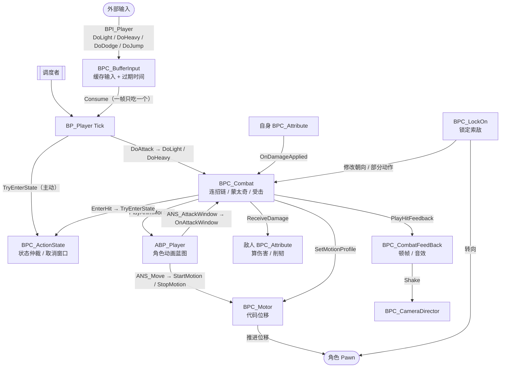
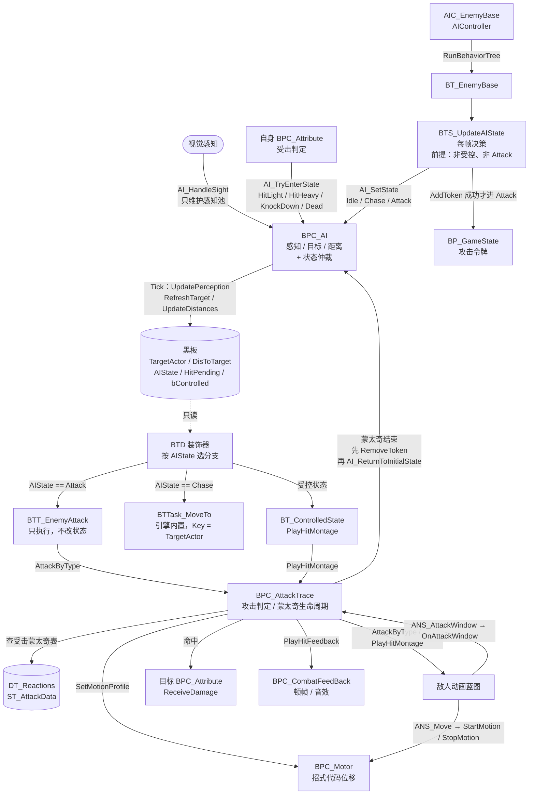

# 运行导图

> 本文件是模块文档。项目总导航、规范与历史见 [README.md](../README.md)。

## 9，运行导图

> 组件之间的实际流转。图上只画调用关系，判断规则看 docs 07~10 的功能实现文档。

### 1）玩家运行导图



**与手绘原图相比，这一版修正了 5 处：**

```
① AbP_Player → ABP_Player（拼写）
② 删掉「BPC_Attribute → 敌人」这条线
   伤害不是从 Attribute 流向敌人，而是 Combat 调「目标」的 ReceiveDamage
③ 标签 GetAttack / TakeDamage → ReceiveDamage
   TakeDamage 是 Attribute 内部自己调的，外部只调 ReceiveDamage
④ 补上 BPC_Motor：ANS_Move 直连 Motor.StartMotion / StopMotion
   Combat 只负责 SetMotionProfile 下发参数（位移职责已移交）
⑤ 补上 BPC_CombatFeedBack + BPC_CameraDirector，以及受击回路
   Attribute.OnDamageApplied → Combat.EnterHit
```

---

### 2）敌人运行导图



**四处最容易画错的连线：**

```
① 行为树不调 BPC_Motor
   BT 里的 MoveTo 走的是 CharacterMovement（寻路移动），不经过 BPC_Motor。
   BPC_Motor 只管「招式代码位移」，调用方只有两个：
     · BPC_AttackTrace（SetMotionProfile）
     · 动画通知 ANS_Move（StartMotion / StopMotion）

② 状态写入只有一个方向：BTS → BPC_AI
   BPC_AI 不决策、不查询上层。
   BTS 用 AI_SetState 请求普通转换，BPC_Attribute 用 AI_TryEnterState 抢占受击/死亡，
   BPC_AttackTrace 用 AI_ReturnToInitialState 回流 —— 三者都是「上层往下写」。

③ BTT / BTD 只读黑板，不改任何值
   改值只有 BTS（决策数据）和 BPC_AI（自己的数据 + AIState）。

④ 受击方向和受击等级是一起走的
   AI_TryEnterState 抢到受控状态后，ApplyState 同步 HitDirection / HitPending，
   Task 读黑板再传给 PlayHitMontage，中间任何一环都不要自己重新算方向。
```

**敌人侧和玩家侧的结构差别：**

```
玩家    输入 → BufferInput → Tick → Combat → 蒙太奇 / Motor / 伤害
        状态归 BPC_ActionState（组件），受击走 Combat.EnterHit

敌人    感知 → BPC_AI（维护数据）→ 黑板 → BTS（决策）→ BTT（执行）
        没有 BPC_ActionState，状态归 E_AIState，由 BPC_AI 仲裁并写进黑板
        受击走 Attribute.OnDamageApplied → 内部受击处理 → AI_TryEnterState，不做 EnterHit

两边共用：BPI_CharacterBase（取组件 / IsCharacterDead / IsHostile）、
         BPC_Attribute（伤害 / GetTeam）、BPC_Motor（招式位移）、
         BPC_CombatFeedBack（反馈）
```

**敌人行为树全部由引擎内置节点 + 三个自定义资产搭成，没有自定义 BTT_MoveToActor / BTD：**

```
BT_EnemyBase
├─ BTS_UpdateAIState            自定义服务（Enemy/AI/Service）
├─ Selector
│   ├─ [BTDecorator_Blackboard] 受控状态 → BTTask_RunBehavior(BT_ControlledState)
│   ├─ [BTDecorator_Blackboard] AIState == Attack → BTT_EnemyAttack
│   ├─ [BTDecorator_Blackboard] AIState == Chase  → BTTask_MoveTo（引擎内置）
│   └─ BTTask_Wait（引擎内置，待机）
```

**⭐ `Chase` 分支直接用引擎的 `Move To`，目标填黑板键 `TargetActor`：**

```
Move To 的 Blackboard Key 选 TargetActor
→ 目标在动，导航系统自动重算路径，敌人持续跟随
→ 不需要每帧下发指令，也不需要一个自定义任务去包一层
```

**⚠️ `Move To` 只在序列/选择器里持续运行时才会持续跟踪。如果它被上层 abort 掉（比如状态切到 Attack），跟随会停止 —— 这是期望行为。**

---

